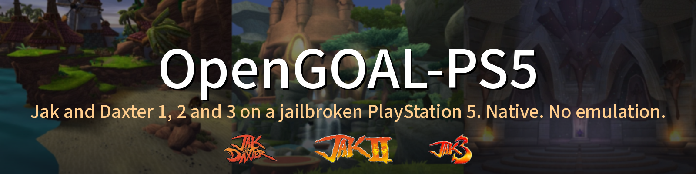
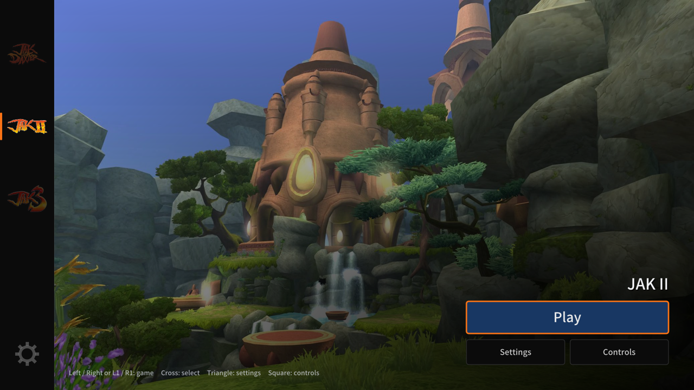
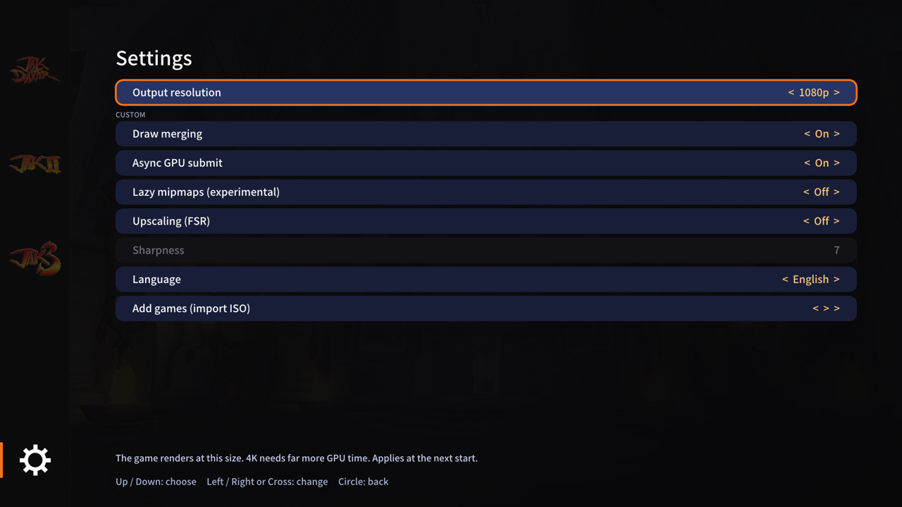
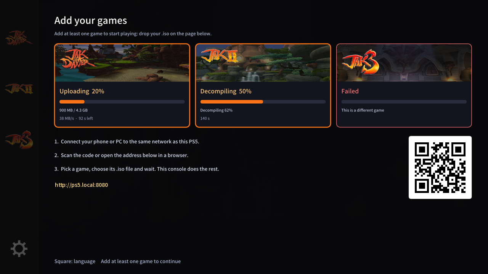
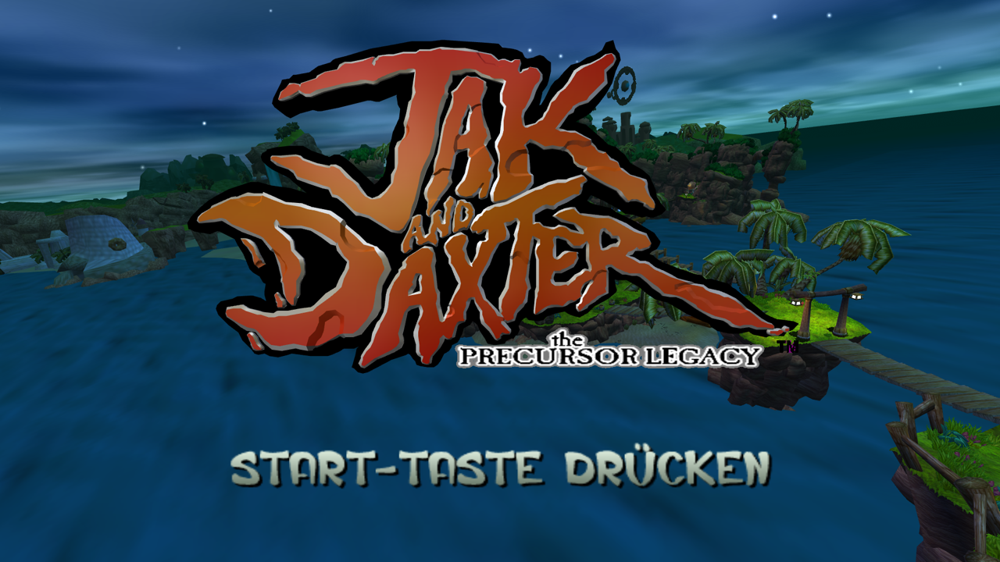
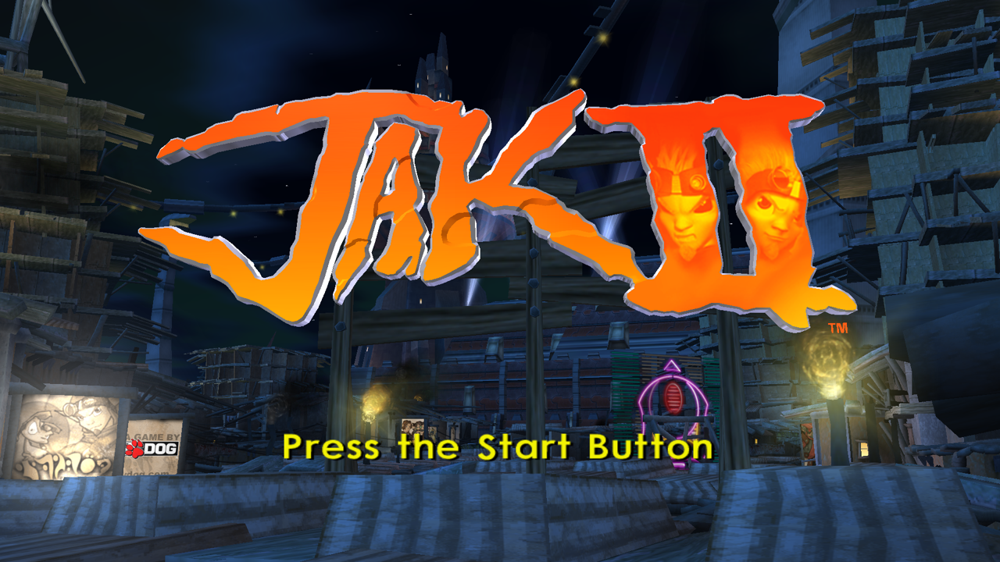

<p align="center">
  
</p>

<p align="center">
  <a href="https://github.com/0iy/opengoal-ps5/actions/workflows/tests.yml"></a>
  
  
  
  
</p>

<p align="center">
  <a href="#start">Start</a> ·
  <a href="#stand">Stand</a> ·
  <a href="docs/INSTALL.md">Installation</a> ·
  <a href="docs/USER_GUIDE.md">Anleitung</a> ·
  <a href="docs/README.md">Doku</a> ·
  <a href="README.md">English</a>
</p>

**Jak and Daxter** 1, 2 und 3 nativ auf einer gejailbreakten PlayStation 5. Port der [OpenGOAL](https://github.com/open-goal/jak-project)-Engine mit
Controller-Launcher, schnellem Spielimport vom PC und einem angepassten OpenGL-zu-AGC-Grafiktreiber. Keine Emulation.

> **Keine Spieldateien enthalten.** Du brauchst deine eigenen, legal erworbenen Discs als `.iso`-Abbild. Das Projekt unterstuetzt keine Raubkopien.

<table>
<tr>
<td width="33%" valign="top"><b>60 fps</b><br>Jak 3 liegt am vsync. Jak 2 erreicht in der Stadt 50 bis 58, vorher 32.</td>
<td width="33%" valign="top"><b>In etwa einer Minute spielbar</b><br>Der PC erledigt die Arbeit und sendet das fertige Spiel. Jak 1: 63 s gemessen.</td>
<td width="33%" valign="top"><b>Fuer den Controller gemacht</b><br>Launcher, Einstellungen und Import gehen vom Sofa aus, Deutsch und Englisch.</td>
</tr>
<tr>
<td width="33%" valign="top"><b>FSR 1.0 und dynamische Aufloesung</b><br>Unter Ausgabegroesse rendern und hochskalieren. Experimentell.</td>
<td width="33%" valign="top"><b>Folgt OpenGOAL</b><br>Ein Sync-Werkzeug wendet alle Patches neu an und meldet, was bricht.</td>
<td width="33%" valign="top"><b>Getestet</b><br>Ein Befehl fuehrt 18 Offline-Pruefungen aus. Eine QA-Pipeline vergleicht fps und Screenshots.</td>
</tr>
</table>

<p align="center">
 
 
 
</p>

<sub>Der Screenshot der Import-Seite zeigt simulierte Werte (es lief kein Import); die anderen stammen von einer Konsole.</sub>

## Start

Du brauchst eine PS5 mit Firmware 13.60 (einzige getestete Version): ELF-Loader (9021), kstuff, FTP (2121) und ShadowMountPlus laufen, einen PC im selben Netz mit Python 3
und deine Spiele als unveraenderte `.iso`-Abbilder.

1. `OpenGOAL-PS5.zip` vom [neuesten Release](https://github.com/0iy/opengoal-ps5/releases/latest) laden und entpacken.
2. App auf der Konsole installieren: `install.bat` (Windows) oder `sh install.sh --lang de` (Linux, macOS) starten, PS5-Adresse eingeben oder Enter fuer die Suche.
3. **OpenGOAL-PS5** auf der Konsole starten und die Spiele vom PC hinzufuegen: eine Zeile einfuegen, ein kleines Fenster oeffnet sich, `.iso`-Dateien hineinziehen:

**Windows** (PowerShell):

```powershell
irm https://github.com/0iy/opengoal-ps5/releases/latest/download/bootstrap.ps1 | iex
```

**macOS und Linux** (Terminal):

```bash
curl -fsSL https://github.com/0iy/opengoal-ps5/releases/latest/download/bootstrap.sh | bash
```

Oder die in der App angezeigte Adresse (QR-Code) am Handy oder PC oeffnen und die `.iso`-Dateien dort senden (langsamer). Mehr: [`docs/INSTALL.md`](docs/INSTALL.md) (Abschnitt Deutsch).

## Stand

v0.1.0, frueher Release. Gemessen bei 1080p, vsync 60 Hz, mit Draw-Zusammenfassung und asynchronem GPU-Senden ([`docs/PERFORMANCE.md`](docs/PERFORMANCE.md)).

| Spiel | Zustand | Bildrate |
|---|---|---|
| Jak 1 | 🟢 spielbar | 58 bis 60 fps (Titel und Intro, PAL-Disc vom PC importiert) |
| Jak 2 | 🟡 spielbar, einzelne Grafikfehler | etwa 50 bis 58 fps in der Stadt (32 fps ohne) |
| Jak 3 | 🟡 spielbar, einzelne Grafikfehler | 59 bis 60 fps im Spiel (43 fps ohne) |

Bekannt: einzelne Grafikfehler, gelegentliche Ruckler. FSR-Hochskalierung ist experimentell ([`docs/FSR.md`](docs/FSR.md)).

## Entwicklung

Aufbau und Build: [`docs/DEVELOPMENT.md`](docs/DEVELOPMENT.md), Beitraege: [`CONTRIBUTING.md`](CONTRIBUTING.md), Tests: `python tests/run_all.py`.

## Rechtliches

Unabhaengiges Fanprojekt, **nicht verbunden mit** Sony Interactive Entertainment, Naughty Dog oder dem OpenGOAL-Team. Marken gehoeren ihren
Inhabern. Das Repository enthaelt keine Spieldaten, Firmware, Schluessel oder Konsolen-Dumps. Nur mit eigenen Spielen und eigener Konsole nutzen.

Lizenz: GPL-3.0-or-later ([`LICENSE`](LICENSE)). Drittkomponenten: [`THIRD_PARTY_NOTICES.md`](THIRD_PARTY_NOTICES.md).
