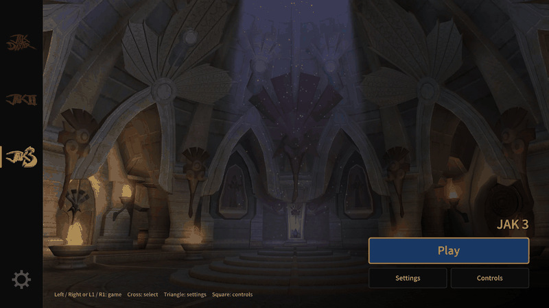
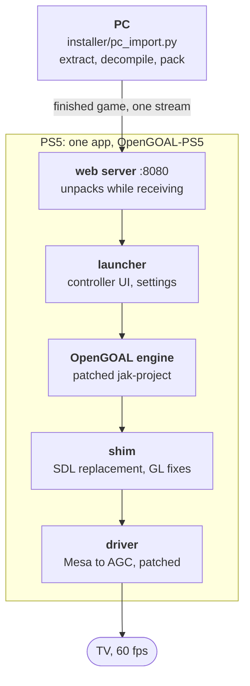

<p align="center">
  
</p>

<p align="center">
  <a href="https://github.com/0iy/opengoal-ps5/actions/workflows/tests.yml"></a>
  
  
  
  
</p>

<p align="center">
  <a href="#start">Start</a> ·
  <a href="#status">Status</a> ·
  <a href="docs/INSTALL.md">Install</a> ·
  <a href="docs/USER_GUIDE.md">User guide</a> ·
  <a href="docs/README.md">Docs</a> ·
  <a href="README.de.md">Deutsch</a>
</p>

Play **Jak and Daxter** 1, 2 and 3 natively on a jailbroken PlayStation 5. A port of the [OpenGOAL](https://github.com/open-goal/jak-project) engine with a
controller launcher, fast game import from your PC and a patched OpenGL-to-AGC graphics driver. No emulation.

> **No game files are included.** You need your own legally owned discs, imported from `.iso` images. This project does not support piracy.

<table>
<tr>
<td width="33%" valign="top"><b>60 fps</b><br>Jak 3 sits at vsync. Jak 2 reaches 50 to 58 in the city, up from 32.</td>
<td width="33%" valign="top"><b>Playable in about a minute</b><br>The PC does the heavy work and sends the finished game. Jak 1: 63 s measured.</td>
<td width="33%" valign="top"><b>Made for a controller</b><br>Launcher, settings and game import all work from the couch, English and German.</td>
</tr>
<tr>
<td width="33%" valign="top"><b>FSR 1.0 and dynamic resolution</b><br>Render below output size and upscale. Experimental.</td>
<td width="33%" valign="top"><b>Follows OpenGOAL</b><br>An upstream sync tool re-applies every patch and tells you what broke.</td>
<td width="33%" valign="top"><b>Tested</b><br>One command runs 18 offline checks. A QA pipeline compares fps and screenshots.</td>
</tr>
</table>

<p align="center">
 
 
 
</p>

<p align="center"><br><sub>Launcher tour, recorded from a console: switch games, open the settings and the controls page.</sub></p>

<sub>The import screenshot shows simulated values (no import was running); the others are from a console.</sub>

## Start

You need a PS5 on firmware 13.60 (the only version tested) with the ELF loader (9021), kstuff, an FTP service (2121) and ShadowMountPlus running, and a PC on the same network
with Python 3.

1. Download `OpenGOAL-PS5.zip` from the [latest release](https://github.com/0iy/opengoal-ps5/releases/latest) and unzip it.
2. Install the app on the console: run `install.bat` (Windows) or `sh install.sh` (Linux, macOS), enter the PS5 address or press Enter to search.
3. Start **OpenGOAL-PS5** on the console, then add your games from the PC. Paste one line, a small window opens, drop your `.iso` files in it:

**Windows** (PowerShell):

```powershell
irm https://github.com/0iy/opengoal-ps5/releases/latest/download/bootstrap.ps1 | iex
```

**macOS and Linux** (Terminal):

```bash
curl -fsSL https://github.com/0iy/opengoal-ps5/releases/latest/download/bootstrap.sh | bash
```

A game is playable about a minute after you start (measured for Jak 1 on a LAN). Or open the address and QR code the app shows on a phone or PC and upload the `.iso` files there (slower). Details: [`docs/INSTALL.md`](docs/INSTALL.md).

## Status

v0.1.0, early release. Measured at 1080p, vsync 60 Hz, draw merging and async GPU submit on ([`docs/PERFORMANCE.md`](docs/PERFORMANCE.md)).

| Game | State | Frame rate |
|---|---|---|
| Jak and Daxter: The Precursor Legacy | 🟢 playable | 58 to 60 fps (title and intro, PAL disc imported from the PC) |
| Jak II | 🟡 playable, some visual glitches | about 50 to 58 fps in the city (32 fps without merging and async submit) |
| Jak 3 | 🟡 playable, some visual glitches | 59 to 60 fps in gameplay (43 fps without), about 3 frames per 3 s over 20 ms |

Known issues: visual glitches in places, occasional frame-time spikes, 4K output is much slower than 1080p on the GPU side. FSR upscaling and dynamic resolution are experimental
([`docs/FSR.md`](docs/FSR.md)). Only firmware 13.60 is tested.

## How it fits together



## Features

- Controller launcher for Jak 1, 2 and 3, English and German
- Game import from the PC (fast) or on the console (web page on port 8080)
- Draw merging and asynchronous GPU submit: about +10 fps in Jak 2, Jak 3 reaches vsync
- In-game option menus lock what makes no sense on a console (display mode, window size, vsync, frame limit)
- Experimental: FSR 1.0 upscaling with dynamic resolution, lazy mipmaps
- Upstream sync tool and a QA pipeline to follow new OpenGOAL versions ([`docs/UPSTREAM_SYNC.md`](docs/UPSTREAM_SYNC.md), [`docs/QA.md`](docs/QA.md))

<details>
<summary><b>FAQ</b></summary>

- **Which firmware works?** 13.60. Others are unknown.
- **Can I use my disc directly?** No. Make an `.iso` image of your own disc first; `.bin/.cue` must be converted.
- **Does it write to my console permanently?** It installs one app folder under `/data/homebrew` and data under `/data/opengoal`. It never changes kernel flags or system settings.
- **Why must kstuff be loaded before OnionHEN?** With OnionHEN's built-in kstuff the app is refused (error `0x80020008`). Load OnionHEN only after the app is running.
- **Can I get 60 fps everywhere?** Jak 3 is at the limit; Jak 2 in the city is about 50 to 58. The remaining cost is CPU time per draw in the driver.

</details>

<details>
<summary><b>Troubleshooting</b></summary>

| Symptom | Try |
|---|---|
| Installer: "[MISSING] ELF loader" or "FTP" | start the exploit, or `ftpsrv-ps5.elf`, and run the installer again |
| App refused at start (`0x80020008`) | OnionHEN was loaded first; restart the jailbreak chain without it |
| Black screen or crash in game | turn off draw merging or async submit in the launcher settings, restart the app |
| Import stops | keep the console awake, check the free disk space, see [`docs/ONBOARDING_WEB.md`](docs/ONBOARDING_WEB.md) |
| Everything silent after rest mode | run the exploit and the loader again; ports 2121 and 9021 may survive, the app may not |

More: [`docs/USER_GUIDE.md`](docs/USER_GUIDE.md).

</details>

<details>
<summary><b>Repository layout</b></summary>

| Folder | Content |
|---|---|
| `app/` | the PS5 app: shim (SDL replacement, launcher, importer, web server, GL fixes) and build scripts |
| `driver/` | patched ps5-opengl graphics driver, build scripts and run-time switches |
| `engine/` | patches for the OpenGOAL engine, upstream sync tool, FSR shaders |
| `payloads/` | small console payloads (kill and launch the app, rescan, keep awake) |
| `tools/` | the `ps5` command line: build, deploy, run, measure, QA, test |
| `installer/` | what the release contains: installer, PC import engine and window, bootstrap scripts |
| `tests/` | offline test suite (`python tests/run_all.py`) |
| `art/`, `docs/` | artwork, documentation |

Build and contribute: [`docs/DEVELOPMENT.md`](docs/DEVELOPMENT.md), [`CONTRIBUTING.md`](CONTRIBUTING.md). Security issues: [`SECURITY.md`](SECURITY.md).

</details>

## Legal

OpenGOAL-PS5 is an independent fan project. It is not affiliated with or endorsed by Sony Interactive Entertainment, Naughty Dog or the OpenGOAL team. "PlayStation", "PS5",
"Jak and Daxter" and related names are trademarks of their owners and are used only to describe compatibility. The repository contains no game data, firmware, keys or console dumps.
Use it only with games you own and on a console you own.

## Credits

[OpenGOAL / jak-project](https://github.com/open-goal/jak-project) (ISC), ps5-opengl (BlackBearReloaded; the original repository is gone, see [`driver/README.md`](driver/README.md)) and
[ps5-native-app-boilerplate](https://github.com/drakmor/ps5-native-app-boilerplate) (GPL-3.0-or-later), [Mesa](https://www.mesa3d.org),
[ps5-payload-dev](https://github.com/ps5-payload-dev) (SDK, ftpsrv, shsrv), kstuff, ShadowMountPlus, etaHEN, FFmpeg (ATRAC9 tables), Noto Sans JP (OFL).
Full list: [`THIRD_PARTY_NOTICES.md`](THIRD_PARTY_NOTICES.md).

## License

GPL-3.0-or-later, see [`LICENSE`](LICENSE).
